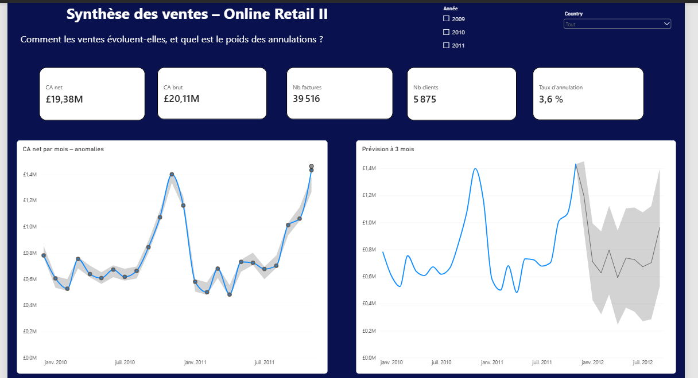
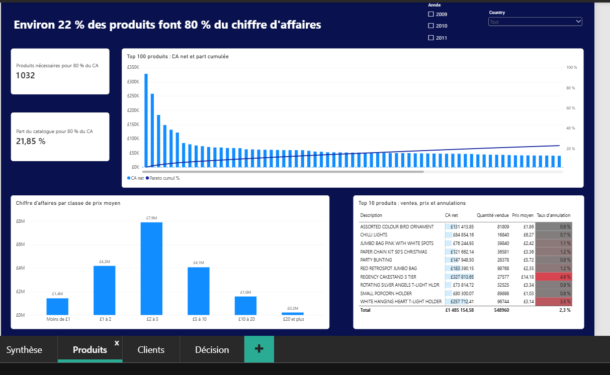
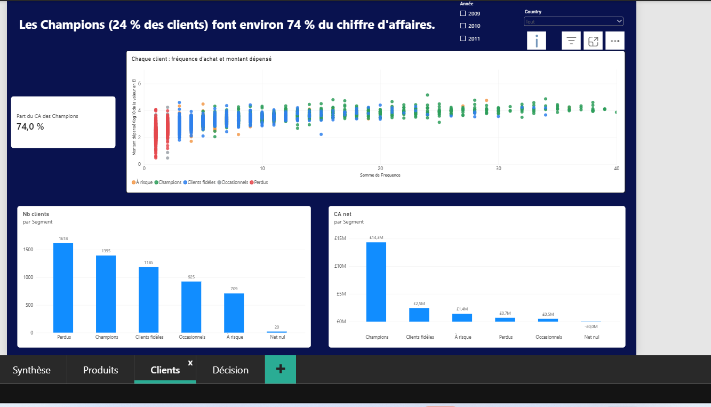
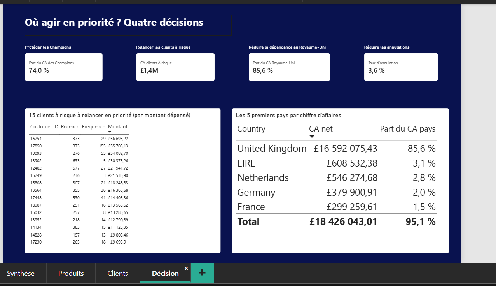

# Analyse des ventes en ligne – Power BI (Online Retail II)

Rapport Power BI en quatre pages, construit de bout en bout (nettoyage Power Query, modèle en étoile, mesures DAX, segmentation RFM) sur les ventes d'une boutique en ligne britannique de cadeaux. Question de départ : **comment les ventes évoluent-elles, qui fait le chiffre d'affaires, et où agir en priorité ?**

## Résultats clés

| Constat | Chiffre |
|---|---|
| Chiffre d'affaires net (ventes moins annulations) | **£19,38 M** |
| Part du chiffre d'affaires annulée | **3,6 %** (£20,11 M brut) |
| Saisonnalité | pic en **novembre** (environ £1,4 M par mois en 2010 et en 2011) |
| Concentration des produits | **21,85 %** des produits (1 032) font **80 %** du CA |
| Prix | les produits à moins de £10 font environ **91 %** du CA ; la classe £2 à £5 pèse à elle seule £7,9 M |
| Clients | les **Champions** (1 395 clients, 24 %) font **74 %** du CA |
| Clients à risque | 709 clients, environ £1,4 M de CA passé ; les plus importants n'ont rien acheté depuis 6 à 21 mois |
| Marchés | le **Royaume-Uni pèse 85,6 %** du CA ; l'Irlande, les Pays-Bas, l'Allemagne et la France font 9,4 % ensemble |
| Annulations | Regency Cakestand 3 Tier (meilleur produit, £327 814) a un taux d'annulation de **4,9 %**, contre 3,6 % en moyenne |

## Les quatre pages

1. **Synthèse** – cartes de synthèse, courbe mensuelle du CA avec détection d'anomalies, prévision à trois mois.
2. **Produits** – courbe de Pareto (top 100), classes de prix, top 10 des produits avec mise en forme conditionnelle.
3. **Clients** – segmentation RFM : nombre de clients et CA par segment, nuage de points fréquence / montant.
4. **Décision** – quatre décisions chiffrées, liste des 15 clients à risque à relancer en priorité, classement des pays.

| | |
|---|---|
|  |  |
|  |  |

## Données

- Source : [Online Retail II (UCI Machine Learning Repository)](https://archive.ics.uci.edu/dataset/502/online+retail+ii), licence **CC BY 4.0**.
- 1 067 371 lignes de factures entre le 1er décembre 2009 et le 9 décembre 2011 ; 8 colonnes (Invoice, StockCode, Description, Quantity, InvoiceDate, Price, Customer ID, Country) ; montants en livres sterling.
- Le fichier de données n'est pas dans ce dépôt (43,5 Mo). Voir [donnees/LISEZ-MOI.md](donnees/LISEZ-MOI.md).

## Modèle de données

Schéma en étoile : une table de faits `FaitVentes` et quatre dimensions (`DimDate`, `DimProduit`, `DimClient`, `DimPays`), plus une table `RFM` reliée à `DimClient` (relation un-à-un). Toutes les autres relations sont un-à-plusieurs, avec filtrage dans un seul sens, depuis la dimension vers la table de faits. Voir la capture [docs/mod%C3%A8le.png](docs/mod%C3%A8le.png).

## Choix techniques et nettoyage

- **Chemin du fichier en paramètre** (`p_FichierSource`) : il suffit de le changer si le fichier est déplacé.
- **Deux feuilles ajoutées l'une à l'autre** (Append), puis requêtes en **référence** plutôt qu'en duplicata : une référence relit la requête d'origine au lieu de recopier ses étapes.
- **Chaque ligne est classée** dans une colonne `TypeLigne` : *Vente*, *Annulation* (facture commençant par « C »), *Ajustement* (quantité négative ou prix nul sans être une annulation) ou *Hors produit* (frais de port, commissions, frais bancaires, etc.). Contrôle de cohérence : 1 037 002 ventes + 18 285 annulations + 12 084 ajustements et lignes hors produit = 1 067 371 lignes.
- **Doublons de clé** : 171 codes produit ne différaient que par la casse (`72349B` et `72349b`). Le modèle ne distingue pas les majuscules des minuscules, donc les clés sont normalisées (suppression des espaces, majuscules) avant d'être déclarées uniques dans `DimProduit` (4 737 codes).
- **Clients manquants** : 22,2 % des lignes n'ont pas d'identifiant client. Elles restent dans l'analyse des ventes, mais pas dans l'analyse client.
- **Périodes incomplètes** : décembre 2009 est le premier mois du fichier et décembre 2011 s'arrête au 9. Ce dernier mois est exclu des courbes mensuelles et de la prévision.
- **Pays pour la carte** : la table `DimPays` contient une colonne `Pays_Carte` qui normalise certains noms (Korea vers South Korea, par exemple). C'est une hypothèse de ma part, pas une information de la source.

## Mesures DAX principales

CA net, CA brut, taux d'annulation, panier moyen, nombre de factures et de clients, comparaison avec l'année précédente, cumul annuel, part du CA par pays, courbe de Pareto cumulée, nombre de produits pour 80 % du CA. Les formules sont dans [mesures-dax/mesures.md](mesures-dax/mesures.md).

## Segmentation RFM

Pour chaque client (5 853 clients) : **récence** (jours depuis le dernier achat), **fréquence** (nombre de factures) et **montant** (CA net). Les scores de récence et de montant sont des quintiles (de 1 à 5) ; celui de fréquence utilise des seuils fixes (1, 2, 3 à 4, 5 à 9, 10 et plus) car beaucoup de clients ont une ou deux commandes et les égalités faussent les quintiles. Les segments sont : Champions, Clients fidèles, À risque, Perdus, Occasionnels, et « Net nul » pour les clients dont les achats sont annulés. Les seuils sont des choix d'analyse, pas des valeurs de référence.

## Limites

- Les segments RFM sont calculés sur toute la période : le segment Année change les montants, pas la classification d'un client.
- La prévision repose sur 23 mois de données (moins de deux cycles saisonniers) : elle est indicative.
- Les données viennent d'un seul détaillant, à clientèle en grande partie professionnelle ; les conclusions ne se généralisent pas à d'autres boutiques.
- Un client manque entre la table `RFM` et `DimClient` dans les graphiques de la page Clients (1 395 Champions au lieu de 1 396), écart négligeable non investigué.
- Pas de sécurité au niveau des lignes ni de publication sur le service Power BI dans cette version.

## Compétences mises en œuvre

Power Query (paramètres, fusion, colonnes personnalisées en M, contrôle qualité des données), modélisation en étoile, DAX (CALCULATE, time intelligence, RANKX, SWITCH, tables virtuelles), segmentation RFM, visualisation (courbes avec prévision et anomalies, nuage de points, mise en forme conditionnelle, segments synchronisés), accessibilité (texte de remplacement, contrastes, ordre de tabulation).

## Auteure

Élisée Dagbo – Master 2 Économétrie et Statistique (Économétrie Appliquée), IAE Nantes.
